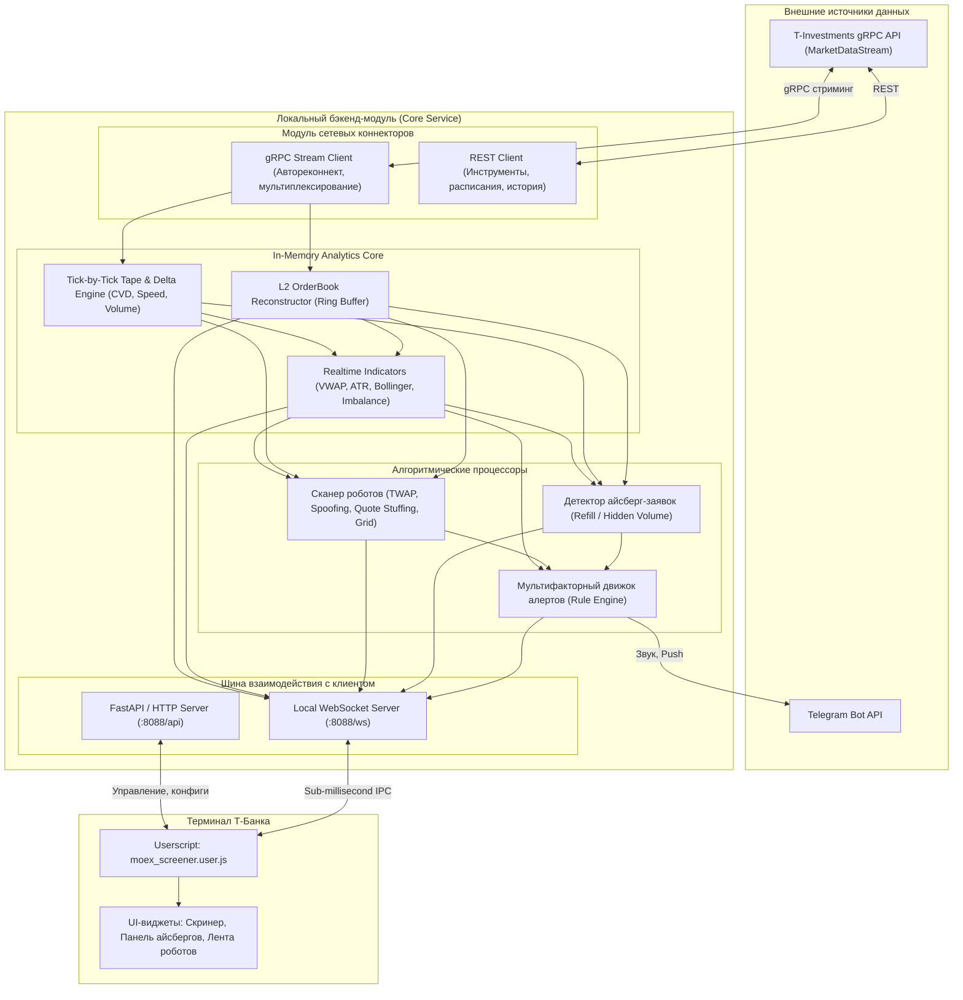
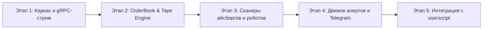

# Техническое задание и системный промт: Локальный бэкенд-модуль MOEX Screener Pro

> **Версия документа:** 1.0  
> **Проект:** MOEX Screener Pro Backend Core  
> **Назначение:** Высокопроизводительный локальный сервис сбора потоковых биржевых данных (T-Bank Invest API gRPC), анализа стакана (L2) и ленты сделок (OrderFlow), выявления айсберг-заявок, детекции алгоритмических торговых роботов, расчета индикаторов и доставки алертов в терминал/Telegram.

---

## 1. Введение и цели системы

### 1.1. Проблематика
Текущая версия системы работает в браузере как Userscript (`moex_screener.user.js`). При расширении функционала (сканирование роботов, скрытых заявок, сотен тикеров в реальном времени):
1. Браузерный JavaScript не рассчитан на расчет потока ордеров (OrderFlow/Tape) по десяткам инструментов одновременно без просадки FPS терминала.
2. Лимиты REST API Т-Инвестиций блокируют частые опросы свечей и стаканов.
3. Встроенная система алертов веб-терминала Т-Банка примитивна (только простое условие цены «выше/ниже», нет фильтров по объему, ленте, дельте, айсбергам).

### 1.2. Решение
Вынос всей тяжелой аналитики на **локальный бэкенд-сервис** (демон/служба на машине трейдера), который:
- Держит единый постоянный gRPC-стрим к Т-Инвестициям (MarketDataStream: стаканы, сделки, свечи).
- Реконструирует биржевой стакан и ленту в оперативной памяти (In-Memory Ring Buffers).
- В реальном времени выполняет алгоритмы детекции: **айсберги**, **роботы (TWAP, спуфинг, айсберг-плиты)**, **аномальная дельта**.
- Раздает готовые агрегированные расчеты в userscript через сверхбыстрый локальный WebSocket (`ws://127.0.0.1:8088/ws`).
- Мгновенно отправляет кастомные алерты в Telegram и системные уведомления Windows/MacOS.

---

## 2. Архитектура системы



---

## 3. Функциональные требования к модулям

### 3.1. Модуль подключения и потока (Ingestion Layer)
* **Технология:** Т-Банк Invest API v2 (gRPC `MarketDataStreamService`).
* **Потоки:**
  - `OrderBook`: глубина до 20–50 уровней по выбранным инструментам.
  - `Trades`: потиковая лента всех сделок (цена, объем, направление лота, timestamp в микросекундах).
  - `Candles`: минутные/секундные свечи.
* **Отказоустойчивость:**
  - Автоматический реконнект с экспоненциальным backoff при обрывах связи.
  - Динамическая подписка/отписка: если пользователь в терминале переключает фильтр или вкладку, бэкенд мгновенно оптимизирует список подписок, оставаясь в лимитах брокера.
  - Поддержка прокси (локальный SOCKS5/HTTP Xray/V2Ray), если брокерский API или Telegram заблокированы провайдером.

---

### 3.2. Детектор айсберг-заявок (Iceberg Scanner Engine)

Айсберг-заявка состоит из видимой части (Visible Size, V) и скрытой (Hidden Size, H). При поглощении видимой части она автоматически пополняется биржей до исчерпания скрытого объема.

#### Алгоритмы детекции:
1. **Refill at Same Price Level (Возобновление плотности):**
   - Условие: на уровне цены $P$ висит лимитный объем $V_{vis}$.
   - По ленте проходит сделка объемом $TradeVol \ge V_{vis}$.
   - В течение $\Delta t < 50$ мс на этом же ценовом уровне $P$ стакан снова показывает появление объема $V_{vis}' \approx V_{vis}$.
   - Детектор фиксирует факт «Пополнение айсберга» и начинает аккумулировать исполненный скрытый объем:
     $$\text{ExecutedHiddenVolume} = \sum TradeVol_{at\_P}$$
2. **Cumulative Trade Volume Discrepancy (Аномальный объем в ленте):**
   - Если суммарный объем прошедших рыночных сделок по цене $P$ превышает изначальную видимую глубину уровня на $N\%$ (например, в 3–5 раз), но уровень цены $P$ не пробит — фиксируется активный айсберг.
3. **Классификация направления:**
   - **Buy Iceberg:** стоит на Bid, поглощает рыночные продажи (аккумуляция крупным игроком).
   - **Sell Iceberg:** стоит на Ask, поглощает рыночные покупки (распределение / сопротивление).
4. **Выходные данные события для UI:**
   - Тикер, время обнаружения, цена, видимый объем, накопленный исполненный объем, примерное число пополнений (refills count), статус (активен / исполнен / снят).

---

### 3.3. Сканер торговых роботов и паттернов (Robot & HFT Detector)

Торговые алгоритмы на MOEX обладают математически вычисляемыми сигнатурами. Бэкенд должен выявлять следующие типы:

#### 1. TWAP / VWAP Execution Bots (Роботы равномерного набора/сброса)
- **Сигнатура:** Серия рыночных или лимитных заявок с одинаковым шагом по времени (например, строго каждые $5.0 \pm 0.1$ сек или каждые $15$ сек) либо одинаковым размером лота (например, ровно 10, 25, 100 лотов).
- **Детекция:** Анализ автокорреляции временных интервалов $(\Delta t_i)$ и распределения объемов сделок.
- **Индикация в терминале:** «Обнаружен TWAP-покупатель: 50 лотов каждые 10 сек (набрано: 15,000 лотов)».

#### 2. Spoofing & Layering (Спуфинг-роботы и мигающие плотности)
- **Сигнатура:** Выставление крупной заявки (в 5–20 раз больше среднего объема в стакане) близко к спреду с последующей быстрой отменой ($\text{TTL} < 500$ мс) при приближении рыночной цены.
- **Цель манипулятора:** Заставить толпу/других роботов ударить по встречной стороне.
- **Детекция:** Фиксация появления лимитной плотности, которая снимается без соответствующих сделок в ленте (Cancellation without Execution).

#### 3. High-Frequency Quoting / Market Makers (Спредовые роботы-пылесосы)
- **Сигнатура:** Симметричное выставление и мгновенная перестановка лучших Bid/Ask при малейшем тике цены базового актива или индекса.
- **Метрика:** Коэффициент агрессивности спреда (Spread Tightness) и скорость реакции на пробой.

#### 4. Iceberg Exhaustion & Sweep Bots (Роботы срыва стопов / пылесосы ликвидности)
- **Сигнатура:** Серия агрессивных рыночных ордеров, бьющих по нескольким уровням стакана за миллисекунды (Sweep), направленная на вынос стоп-лоссов за локальными экстремумами.

---

### 3.4. Мультифакторный движок алертов (Custom Alert Engine)

В отличие от стандартного терминала, система должна поддерживать гибкие логические формулы с булевой логикой (`AND`, `OR`, `NOT`) и временными окнами.

#### Поддерживаемые условия:
- **Ценовые и уровневые:**
  - Цена пересекает уровень $X$, приближение к локальному максимуму дня / сессии ($< 0.15\%$).
- **Объемные и потоковые (OrderFlow):**
  - Относительный всплеск объема: $Volume_{1m} > 3 \times SMA(Volume, 20)$.
  - Аномальная кумулятивная дельта (CVD): дельта покупок за 3 минуты $> 75\%$ от общего объема.
- **Событийные (Algo events):**
  - Появление айсберга объемом $> 10\,000$ лотов или $> 5$ млн руб.
  - Детекция активности TWAP-робота в сторону лонга.
  - Крупная плотность в стакане на расстоянии не более 3 шагов цены.
- **Комбинированные (пример):**
  ```text
  [ТИКЕР == SBER] AND 
  [Цена в пределах 0.2% от 280.00] AND 
  [Дельта_5m > +10,000 лотов] AND 
  [Обнаружен Buy-Iceberg на 279.80]
  ```

#### Каналы доставки алертов:
1. **Local Push в браузерный терминал:** Мгновенный всплывающий баннер, подсветка строки в таблице скринера, звуковой сигнал (Web Audio API).
2. **Telegram Bot:** Push-сообщение с кнопками (тикер, скриншот параметров, ссылка на открытие терминала).
3. **Windows Native Toast:** Всплывающее окно в правом нижнем углу экрана ОС.

---

### 3.5. Локальный транспортный протокол (IPC & WebSocket)

Бэкенд поднимает локальный сервер на порту `8088` (по умолчанию `127.0.0.1:8088`):

#### WebSocket Endpoint: `ws://127.0.0.1:8088/ws`
- **Протокол:** Двунаправленный JSON (или бинарный MessagePack для максимальной скорости).
- **События от Бэкенда к Расширению:**
  - `TICKER_UPDATE`: обновление строки скринера (цена, объемы, дельта, статус роботов).
  - `ICEBERG_ALERT`: появление или обновление айсберга.
  - `ROBOT_DETECTED`: обнаружение сигнатуры алгоритма.
  - `CUSTOM_ALERT`: срабатывание пользовательского правила.
- **Команды от Расширения к Бэкенду:**
  - `SUBSCRIBE_TICKERS`: передача списка активных тикеров из текущего фильтра расширения.
  - `SET_ALERT_RULE`: сохранение нового правила алерта.
  - `PING` / `PONG`: контроль соединения.

#### REST API Endpoints: `http://127.0.0.1:8088/api/v1/`
- `GET /health` — статус брокерского коннекта, пинг до биржи, загрузка памяти.
- `GET /instruments` — список торгуемых акций MOEX и их параметров (шаг цены, лотность, статус торгов).
- `GET /icebergs/active` — текущие активные айсберги.
- `GET /robots/active` — активные роботы по инструментам.
- `POST /alerts` — создание/редактирование правила.
- `GET /config` & `POST /config` — настройки токенов, Telegram-бота, порогов чувствительности.

---

## 4. Стек технологий и обоснование

| Компонент | Рекомендуемый стек | Обоснование |
|---|---|---|
| **Язык разработки** | **Python 3.11+ (Asyncio)** или **Node.js (TypeScript)** | **Python:** Наличие готового официального SDK `tinkoff-invest-api` (gRPC), библиотек скоростной аналитики (`numpy`, `polars`).<br>**TypeScript:** Общий язык с userscript, единый код типов моделей данных. |
| **Сетевой фреймворк** | **FastAPI + Uvicorn** (если Python) / **Fastify + ws** (если Node.js) | Сверхнизкий оверхед, нативная поддержка WebSocket и асинхронного Event Loop. |
| **gRPC клиент** | `tinkoff.invest.AsyncClient` | Полная поддержка стриминга `MarketDataStream` с асинхронными генераторами. |
| **In-Memory хранилище** | Кольцевые буферы (`collections.deque` / структуры C-типа в памяти) | Быстрая работа без дискового I/O: задержка обработки тика $< 0.5$ мс. |
| **Хранилище настроек и истории** | **SQLite (WAL mode)** или **DuckDB** | Легковесная локальная база данных в одном файле, не требующая установки PostgreSQL/Redis. |
| **Уведомления** | `aiogram` / `python-telegram-bot` + `win10toast` / `plyer` | Быстрая отправка без блокировки основного цикла. |

---

## 5. Дорожная карта разработки (Roadmap)



1. **Этап 1: Инфраструктура и коннекторы:**
   - Создание структуры проекта, конфигурация окружения (`.env`, настройки портов, токен Т-Банка).
   - Подключение `MarketDataStream` (gRPC), автореконнект, подписка на топ-20 ликвидных акций MOEX.
2. **Этап 2: Буфер стакана и ленты сделок:**
   - Построение потикового агрегатора сделок, расчет кумулятивной дельты (CVD) и скорости ленты.
3. **Этап 3: Алгоритмические детекторы:**
   - Реализация алгоритма выявления айсбергов по возобновлению плотности.
   - Реализация сигнатур TWAP/VWAP и спуфинга.
4. **Этап 4: Система алертов:**
   - Синтаксис правил, триггеры, интеграция с Telegram-ботом.
5. **Этап 5: Локальный WebSocket-сервер и стыковка с Userscript:**
   - Реализация клиента в `moex_screener.user.js` (автоподключение к `ws://127.0.0.1:8088/ws`).
   - Отображение меток айсбергов и роботов прямо в строках скринера и в стакане терминала.

---

## 6. ГОТОВЫЙ МАСТЕР-ПРОМТ ДЛЯ ИИ-РАЗРАБОТЧИКА / АГЕНТА

Ниже приведён готовый системный промт (Prompt), который можно скопировать и запустить для создания данного бэкенда с нуля.

````markdown
Ты — ведущий HFT/Quant-разработчик биржевого ПО и эксперт по сетевым протоколам (Python, Asyncio, gRPC, WebSocket).
Твоя задача — создать локальный бэкенд-сервер для проекта "MOEX Screener Pro", который в реальном времени собирает данные с Т-Инвестиций через gRPC, анализирует стакан (L2) и ленту сделок, обнаруживает айсберг-заявки и торговых роботов, рассчитывает кастомные алерты и транслирует результаты через локальный WebSocket в браузерный Userscript.

### Стек и архитектура:
1. Язык: Python 3.11+ с asyncio.
2. Сеть: FastAPI + Uvicorn + WebSocket сервер на 127.0.0.1:8088.
3. Биржа: Официальный `tinkoff-invest-api` (AsyncClient, gRPC MarketDataStream).
4. База данных: SQLite (WAL-режим) для хранения правил алертов, истории срабатываний и конфигураций.
5. Алгоритмы: Потиковая детекция айсбергов (refill visible volume) и TWAP/спуфинг роботов с помощью кольцевых буферов в оперативной памяти.
6. Оповещения: Локальный WebSocket в терминал + Telegram Bot (aiogram) + Windows toast notifications.

### Структура проекта:
```
backend/
├── app/
│   ├── api/                  # FastAPI роуты (REST & WebSocket)
│   │   ├── routes.py         # REST: /health, /instruments, /alerts, /config
│   │   └── websocket.py      # WS: /ws (трансляция событий клиенту)
│   ├── core/
│   │   ├── config.py         # Настройки pydantic-settings (.env)
│   │   ├── database.py       # SQLite connection & schema
│   │   └── event_bus.py      # Внутренняя шина событий (pub/sub asyncio)
│   ├── services/
│   │   ├── tbank_grpc.py     # gRPC клиент T-Investments (MarketDataStream)
│   │   ├── orderbook.py      # In-memory L2 стакан и кольцевой буфер ленты
│   │   ├── iceberg_detector.py # Сканер скрытых айсберг-заявок
│   │   ├── robot_detector.py # Сканер TWAP, спуфинга и HFT-паттернов
│   │   ├── alert_engine.py   # Мультифакторные правила алертов
│   │   └── telegram_notifier.py # Телеграм-бот для доставки сигналов
│   └── main.py               # Точка входа приложения
├── requirements.txt
├── .env.example
└── README.md
```

### Ключевые требования к реализации:
1. **Безопасность и отказоустойчивость:** Никаких блокирующих вызовов в основном потоке asyncio. Автоматический реконнект к gRPC при любых сбоях сети с сохранением подписок.
2. **Алгоритм детектора айсбергов:**
   - Отслеживать исполнение крупных сделок на одном ценовом уровне.
   - Если видимый объем на уровне $P$ поглощен, но в пределах 100 мс восстанавливается, фиксировать айсберг.
   - Считать суммарно поглощенный скрытый объем и отправлять событие `ICEBERG_DETECTED`.
3. **Алгоритм детектора роботов:**
   - Выявлять серии сделок с одинаковым шагом по времени ($\Delta t$) и одинаковым объемом лота (TWAP).
   - Выявлять кратковременные плотности в стакане, отменяемые перед сделкой (Spoofing).
4. **WebSocket-протокол с фронтендом:**
   - Эндпоинт `ws://127.0.0.1:8088/ws`.
   - Клиент шлет: `{"type": "SUBSCRIBE", "figis": ["BBG...", ...]}`.
   - Сервер шлет: `{"type": "ALERT", "data": {...}}`, `{"type": "ICEBERG", ...}`, `{"type": "TICKER_STATS", ...}`.
5. **Конфигурация через `.env`:**
   - `TBANK_TOKEN`, `TELEGRAM_BOT_TOKEN`, `TELEGRAM_CHAT_ID`, `PROXY_URL` (SOCKS5/HTTP).

Напиши чистый, типобезопасный, продакшен-готовый код с обработкой ошибок и подробными комментариями на русском языке.
````
